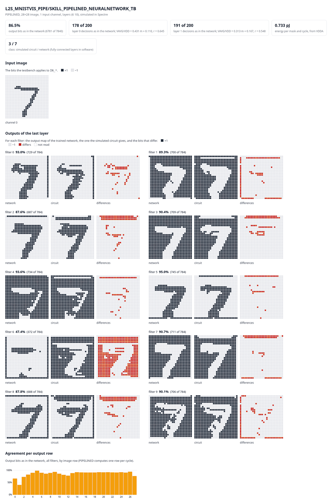

# BNNtoCMOS

BNNtoCMOS turns a trained binarized convolutional neural network (BNN) into
the device-level schematic of a mixed-signal in-memory-computing (IMC) SRAM
circuit in Cadence Virtuoso. It builds everything from the 3×3 convolution
mask up to the whole network. With it come a Spectre testbench that checks
the circuit against the network, and an estimate of area, latency and energy.
It is the tool of

> F. J. Andreo-Oliver, G. Doménech-Asensi, J. A. Díaz-Madrid,
> *Device-Level Synthesis of Mixed-Signal CMOS In-Memory-Computing Circuits for
> Binarized CNNs*, submitted to the International Journal of Circuit Theory and
> Applications.

It generates two architectures:
- **FLASH:** each layer processes a whole image in one clock cycle.
- **PIPELINED:** each layer processes one image row per cycle, in step with
  the column-parallel read-out of an image sensor. It uses far less silicon
  area.



*The results page that a generated testbench writes: the MNIST network of the
paper in PIPELINED (1,848 masks), simulated in Spectre with the authors'
reference cells for test image 0. It shows the input image and, for each filter
of the second layer, the output of the trained network, the output of the
simulated circuit, and the bits that differ.*

## Contents

| | |
|---|---|
| `skill/` | SKILL generators, testbench generator and estimate report. `MAIN_PARAMETERS.il` is the entry point and documents every setting |
| `parser/` | `bnn_to_skill.py`: Keras HDF5 or ONNX model → SKILL parameter file |
| `examples/quickstart/` | a 6×6 network with layers of 2 and 4 filters, to generate and simulate in one step |
| `examples/mnist/` | the MNIST network of the paper: the trained model (`mnist_bnn.h5`), its parameter file, and test image 0 |
| `docs/components.md` | the component cells that the generators instantiate, and their pins |

## Requirements

- **Cadence Virtuoso, OCEAN and Spectre.**
- **Component cells.** A library with the cells listed in
  [docs/components.md](docs/components.md): the IMC bitcell, the precharger,
  the write drivers and, for PIPELINED, the row buffer, the switch matrix and a
  reset NMOS. The cells of the paper are not distributed; any cells with
  the same pins work.
- **Python 3.9+** for the parser (`pip install -r parser/requirements.txt`).
  It runs on any machine; copy the file it writes to the Virtuoso server.

## Quick start

From an empty working directory:

```bash
cp /path/to/BNNtoCMOS/examples/quickstart/cds.lib.example cds.lib       # edit: your library paths
cp /path/to/BNNtoCMOS/examples/quickstart/models.il.example models.il   # edit: your Spectre models
sh /path/to/BNNtoCMOS/examples/quickstart/run_quickstart.sh models.il
```

It generates the quick-start network in both architectures, each with a
testbench, a results page (`.html`) and a report, and simulates them. The last
lines of each testbench compare the circuit with the network:

```
B2C-TB-CHECK layer 0, ... VAVG/VDD = <gain>*m + <offset>, r = ...
B2C-TB-OUTPUT <n> of 144 output bits as in the network
B2C-TB-ENERGY ... J per mask and cycle ...
```

The first run uses ideal charge sharing for the thresholds. Enter the gain and
offset that it prints in `TB_VAVG_TRANSFER`, and the energy in
`REPORT_ENERGY_PER_MASK_CYCLE` (both in `skill/MAIN_PARAMETERS.il`), and run it
again: the thresholds then match your cells.

## Usage

1. **Translate the trained network** into the SKILL parameter file:

   ```bash
   python3 parser/bnn_to_skill.py model.onnx -o NETWORK_PARAMETERS.il
   ```

   The input is a Keras model saved with `model.save()`, or an ONNX export
   (for example from PyTorch). The parser refuses what the circuit cannot
   build. Supported:
   - 3×3 convolutions with stride 1 and "same" padding with −1 (train with
     `pad_values=-1.0`), each optionally followed by batch normalization, and
     binarized with a sign function;
   - then optionally flatten and dense layers, whose weights are exported;
   - no pooling and no branches. No two convolution layers can have the same
     number of filters, because layer cells are named after it.

2. **Configure** in `skill/MAIN_PARAMETERS.il`:
   - `NETWORK_FILE`;
   - `CONFIG` (`"FLASH"`, `"PIPELINED"` or `"BOTH"`);
   - the output libraries, and the names of your component cells;
   - optionally:
     - `TB_GENERATE = t`, `TB_IMAGE` and `TB_MODEL_FILES` for a testbench;
     - `BATCHNORM_MODEL = "ahdlLib"` for batch-norm cells that compute;
     - `REPORT = t` for the estimate.
3. **Generate**, in the CIW:

   ```
   BNNTOCMOS_DIR = "/path/to/BNNtoCMOS/skill"
   load(strcat(BNNTOCMOS_DIR "/MAIN_PARAMETERS.il"))
   ```

4. **Simulate:** `ocean -nograph < <library>_<network>_TB/<network>_TB.ocn`.

**The MNIST network of the paper.** `python3 parser/bnn_to_skill.py
examples/mnist/mnist_bnn.h5 -o NETWORK_PARAMETERS.il` writes
`examples/mnist/NETWORK_PARAMETERS.il` again. To generate it with a testbench
for test image 0, as in the figure above:

```
BNNTOCMOS_DIR = "/path/to/BNNtoCMOS/skill"
B2C_NO_RUN = t
load(strcat(BNNTOCMOS_DIR "/MAIN_PARAMETERS.il"))
NETWORK_FILE = strcat(BNNTOCMOS_DIR "/../examples/mnist/NETWORK_PARAMETERS.il")
load(NETWORK_FILE)
load(strcat(BNNTOCMOS_DIR "/../examples/mnist/TEST_IMAGE.il"))
TB_GENERATE = t
BATCHNORM_MODEL = "ahdlLib"
load("models.il")    ; TB_MODEL_FILES, as for the quick start
b2cGenerate("PIPELINED")
```

Its simulation takes about 2 hours of Spectre.

## What it generates

| Level | Cell | FLASH | PIPELINED |
|---|---|---|---|
| 5. Conv2D 3×3 | `SKILL_<ARCH>_MASK_8T` | 9 bitcells, precharger, write driver | the same, plus a 3-row buffer, 3 switch matrices and a reset transistor |
| 4. Conv2D line | `SKILL_<ARCH>_CHANNEL_8T` | H×W masks: the whole image | W masks: one image row |
| 3. Conv3D (filter) | none | the C channels of a filter share their averaging nodes `VAVG_<f>_*` | same |
| 2. Layer | `SKILL_<ARCH>_LAYER_8T_<F>` | C×F channels and a batch-norm cell | same |
| 1. Network | `SKILL_<ARCH>_NEURALNETWORK` | the layers in cascade, with pins and a symbol | same |

## Testbench and estimate

**Testbench** (`TB_GENERATE = t`). The stimulus follows from the network: the
weight write, the thresholds, the image, and a schedule of compute cycles for
the architecture. The generated OCEAN script simulates the circuit and checks
every layer's `VAVG`, the comparator decisions, the network outputs and, with
a fully connected layer, the class against the trained network. It also
measures the energy, and writes the results page shown above.

**Estimate** (`REPORT = t`). `<library>_report.txt` gives the cell counts,
the area, the connections placed, latency, throughput and energy. The area is
the bounding box of each component's layout view times its instances: active
cell area, without routing. The energy is `REPORT_ENERGY_PER_MASK_CYCLE`, which
you measure with the testbench. Neither is built into BNNtoCMOS.

## Limitations

- **Batch norm.** The batch-norm cells are placeholders for your comparator.
  `BATCHNORM_MODEL = "ahdlLib"` fills them with behavioural cells, for
  simulation.
- **Fully connected layers.** They are not generated: their weights are
  exported, and the testbench applies them in software.
- **Kernel.** The kernel is fixed at 3×3.

## Citation

If you use BNNtoCMOS, please cite the article (see also `CITATION.cff`):

> F. J. Andreo-Oliver, G. Doménech-Asensi, J. A. Díaz-Madrid,
> *Device-Level Synthesis of Mixed-Signal CMOS In-Memory-Computing Circuits for
> Binarized CNNs*, submitted to the International Journal of Circuit Theory and
> Applications.

## License

Copyright (c) 2026 F. J. Andreo-Oliver, G. Doménech-Asensi, J. A. Díaz-Madrid.

BNNtoCMOS is licensed under the
[Creative Commons Attribution 4.0 International License](https://creativecommons.org/licenses/by/4.0/)
(CC BY 4.0); the full text is in [LICENSE](LICENSE). You may use, share and
adapt it for any purpose, including commercially, provided that you give
appropriate credit: name the authors, link to this repository, state the
license, and indicate whether you made changes. In academic work, please cite
the article (see [Citation](#citation)).
